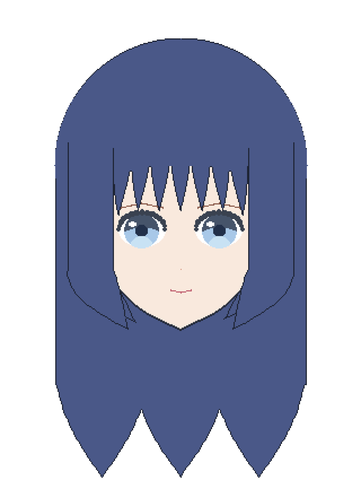
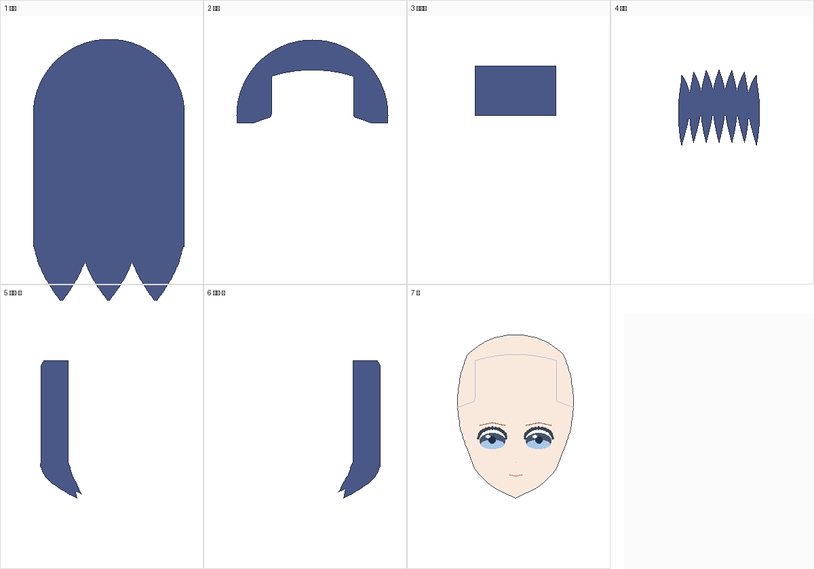

# 从零画一张动漫脸：给 AI 的完整手册

> 一份写给 **语言模型** 的像素画教程。它不教"审美"，只教**怎么把一个形状写成可复现的参数**，以及在人类说"不对"时该改哪个数。

## 先看这里（30 秒判断要不要往下读）

```
给谁看：会写代码、但没有手感的 AI；或者想用程序化方法画像素画的人
需要：  Python 3 + Pillow + numpy；一点耐心；一个会骂你的主人
能做出：从空画布到一张完整动漫脸（脸型/五官/发际线/六层头发），全部参数化
做不出：风格、味道、动态姿势；判断"好不好看"永远得人来
诚实声明：个人实验记录，不保证维护；数值是这一版的，改需求要重算
```



## 它教会你什么

一个 AI（或任何只会写代码、没有手感的人）读完 `docs/从零画一张脸.md`，可以独立从空画布画到下面这个成品：

- 脸型（从 `r/√2` 推出内接方框 + 圆弧脸颊 + 贝塞尔下巴）
- 五官（眼宽/眼距/眼高/嘴高全部由脸宽算出；一只眼的 5 层画法 + 睫毛）
- 发际线（五段结构，含两个"转折点"）
- 头发（六层叠法：后发 / 脸 / 头顶 / 刘海 / 垫底片 / 侧发）



## 核心主张

```
你不需要"会画"，你需要：
  ① 一个可参数化的最小元素（本文用"柳叶"）
  ② 元素之间能用几何算的排布规则（绝不靠估）
  ③ 正确的图层顺序（画错 = 东西凭空消失）
  ④ 每步"什么样算对"的可验证判据（像素数 / 漏光数 / diff）
```

工作循环：`写函数 → 出图 → 人类判"对不对" → 改一个参数 → 再出图`。
**每次只动一个变量**——人类说不清哪里不对，但能说"这版比上版好"。

## 目录（按建议阅读顺序）

```
docs/从零画一张脸.md            ① 主文档（13 章：脸型→五官→发际线→柳叶→排布→图层→描边→参数表→故障表→实例→边界）
docs/量图工具.md                ② 怎么把画面变成数字（含更专业的替代方案：scipy / OpenCV / ImageJ）
docs/失败记录.md                ③ 真正踩过的坑（外星人、垫底片消失、眼睛偏 1 像素、闭运算毁掉分束）
docs/零件参数与坑.md            ④ 零件级记录，更零碎，配合主文档查
docs/怎么给AI下指令.md          ⑤ 给"人"看：把"我想要什么"说成它能执行的参数（不需要懂代码）
code/柳叶工具.py                最小元素（可 import：柳叶掩码(W,H,A,B,弯,宽,位,端正)）
code/脸与五官-生成器.py          脸型 + 五官 + 发际线
code/重组-生成器-相对版.py        整套头发：六层合成 + 拆解图（所有定位都是 r 的倍数）
code/重组-生成器.py              同一套的早期绝对坐标版（留作对照）
code/量图工具.py                量色块位置 / 比两张图的差异
images/                        成品图、拆解图、各零件定稿图
```

运行环境：`Python 3 + Pillow + numpy`。脚本里路径是写死的（原作者本机），改成本地路径即可跑。

## 量图工具（重要）

语言模型看的是块状摘要，估不出精确坐标。所以凡是要准的地方都走程序：

```bash
python code/量图工具.py 量 参考图.png 100 --色 "#d896a9"    # 量某个颜色占哪块
python code/量图工具.py 比 旧图.png 新图.png                 # 改一个参数后验证生效
```

`比` 的经验阈值：几十~几百像素 = 描边级变化；几千以上 = 形状级变化；个位数 = 参数没生效。
详见 `docs/量图工具.md`。

## 几条最值钱的结论

1. **"饱满又尖"要两个因子相乘**：`(1−t^2.2)^0.70 × (1−t)^0.35`。只调一个指数，要么胖到不尖，要么尖到干瘦。
2. **先弯、再量实测宽度、再定间距**。先排后弯会出白缝（弯了以后横向占宽变小）。
3. **发根要沿发际线的法线起势**，不是一律向下——否则看着像贴在颅骨上。
4. **两趟画**：先全部填色，再统一描边。否则后画的填色会盖掉前面的分束线。
5. **复制品做分叉时，偏移在本体走向上的投影必须 ≤ 0**，否则看着像"把本体拉长"。
6. **别用整张合成图 paste**（不透明白底会盖掉下层），一律用掩码落色。
7. **别用"接近纯白"当背景判定**（眼白也是纯白），条件要加"且不在脸轮廓内"。
8. **M 型刘海两侧片的末端要落在"侧发的竖直中线"上**，停在半空就成三根并排的棍子。
9. **PIL 的颜色必须给三元组**：写 `0xf8f2ee` 会被当成 `0xBBGGRR`，整张图发蓝。

## 它做不到的事

- 判断"好不好看"——必须人类当裁判
- 从参考图读出"手感"，只能读出结构（几片、多长、往哪弯）
- 一眼看出"这版和上版差在哪"——只能靠 diff 像素数或人类指出
- 画动态姿势/复杂透视——这套流程只处理"正面、静态、参数化"的部分

完整的边界与故障对照表见 `docs/从零画一张脸.md` 的第 10、12 章。

## 许可

- 文档：CC BY 4.0
- 代码：MIT

署名：`格` / 2026-11-17。一整天迭代 17 版的实践记录；文中所有"坑"都是真的踩过的。
